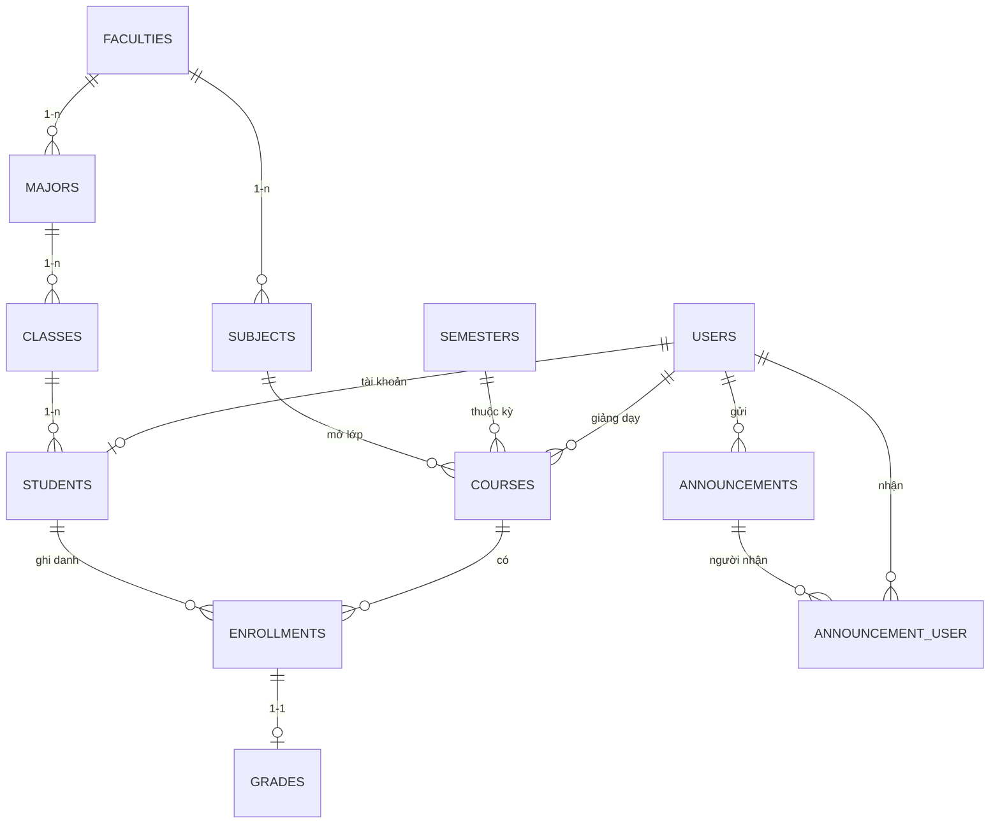

# TÀI LIỆU TỔNG HỢP DỰ ÁN — WEBSITE QUẢN LÝ SINH VIÊN

> **Phiên bản:** 1.0 · **Cập nhật:** 18/10/2026 · **Trạng thái:** MVP đã hoàn thiện
>
> Tài liệu này hợp nhất ba tài liệu:
> `README.md`, `AGILE_QLSV.md` và `SPRINT_CHI_TIET.md`.
>
> **Nguyên tắc:** đây là **nguồn thông tin chính** khi bàn giao/demo. Các nội dung cũ mâu thuẫn với repo thực tế
> (Bootstrap, Breeze, Spatie Permission, Excel/DomPDF) đã được thay bằng quyết định kỹ thuật đang áp dụng
> (Tailwind CSS 4, auth tự viết, `users.role`, CSV tương thích Excel, in/Lưu PDF từ trình duyệt).
>
> | Hạng mục | Giá trị thực tế |
> |---|---|
> | Stack | Laravel **13.35** · PHP **8.3.30** · MySQL **8.4** · Tailwind CSS 4 + Vite 8 · PHPUnit 12 |
> | CSDL | Database `qlsv`, charset `utf8mb4`; **12 migration nghiệp vụ** đã chạy |
> | Quy mô | 4 vai trò · 9 Epic (E1–E9) · **Sprint 0 + Sprint 1–6** ≈ 13 tuần |
> | Kiểm thử | **19 test / 143 assertion** pass; chạy trên SQLite `:memory:` |
> | Tài khoản demo | 5 tài khoản thuộc 4 vai trò (mục 1.4) |

---

## MỤC LỤC

1. [Tổng quan dự án](#1-tổng-quan-dự-án)
2. [Công nghệ & kiến trúc](#2-công-nghệ--kiến-trúc)
3. [Cài đặt, cấu hình & chạy dự án](#3-cài-đặt-cấu-hình--chạy-dự-án)
4. [Chức năng & phân quyền](#4-chức-năng--phân-quyền)
5. [Mô hình dữ liệu](#5-mô-hình-dữ-liệu)
6. [Quy trình Agile/Scrum & quyết định kỹ thuật](#6-quy-trình-agilescrum--quyết-định-kỹ-thuật)
7. [Product Backlog & lộ trình phát hành](#7-product-backlog--lộ-trình-phát-hành)
8. [Kế hoạch Sprint chi tiết](#8-kế-hoạch-sprint-chi-tiết)
9. [Ước lượng & năng lực thực hiện](#9-ước-lượng--năng-lực-thực-hiện)
10. [Kiểm thử, bảo mật & UAT](#10-kiểm-thử-bảo-mật--uat)
11. [Rủi ro & giảm thiểu](#11-rủi-ro--giảm-thiểu)
12. [Roadmap sau MVP](#12-roadmap-sau-mvp)
13. [Cheat sheet lệnh thường dùng](#13-cheat-sheet-lệnh-thường-dùng)
14. [Checklist bàn giao & bước tiếp theo](#14-checklist-bàn-giao--bước-tiếp-theo)
15. [Tài liệu tham chiếu](#15-tài-liệu-tham-chiếu)

---

## 1. Tổng quan dự án

### 1.1. Mục tiêu

Xây dựng website quản lý sinh viên bằng **Laravel + MySQL**, phân quyền theo vai trò, thay thế quản lý thủ công/Excel;
có danh mục học vụ, hồ sơ sinh viên, lớp học phần, nhập điểm – tính GPA, dashboard thống kê, báo cáo và thông báo nội bộ.

### 1.2. Phạm vi

**Trong phạm vi MVP:**

- Đăng nhập/đăng xuất, phân quyền **Admin / Giáo vụ / Giảng viên / Sinh viên**.
- Quản lý danh mục: Khoa, Ngành, Lớp hành chính, Môn học, Học kỳ.
- Quản lý sinh viên: CRUD, hồ sơ, ảnh đại diện, import CSV, tìm kiếm/lọc, xoá mềm/khôi phục, cấp tài khoản.
- Lớp học phần: mở lớp, phân công giảng viên, ghi danh/rút sinh viên.
- Điểm: nhập QT/Thi, tự tính TB – điểm chữ – hệ 4 – đạt/không đạt – GPA; chốt điểm chống sửa.
- Cổng sinh viên: bảng điểm, GPA, in/Lưu PDF.
- Dashboard 4 vai trò; báo cáo CSV/in PDF; thông báo theo nhóm người nhận.

**Ngoài phạm vi (giai đoạn sau):** thanh toán học phí online, đăng ký tín chỉ nâng cao, điểm danh QR,
ứng dụng mobile, email/realtime notification, audit log đầy đủ.

### 1.3. Trạng thái hiện tại

| Hạng mục | Kết quả |
|---|---|
| Migration | 12 migration nghiệp vụ đã chạy trên MySQL `qlsv` |
| Seeder | 5 user, 3 khoa, 4 ngành, 6 lớp, 7 môn, 3 học kỳ, 15 SV, 6 lớp HP, 25 ghi danh, 17 điểm, 3 thông báo |
| Test | `php artisan test`: **19 passed, 143 assertions** |
| Code style | `vendor/bin/pint --test`: pass |
| Frontend | `npm run build`: thành công; Tailwind CSS 4 + Vite 8 |
| Bảo mật | Middleware role, CoursePolicy, chặn IDOR, CSRF, validate input |
| Báo cáo | CSV UTF-8 có BOM (mở bằng Excel) + trang in/Lưu PDF bằng trình duyệt |

### 1.4. Tài khoản demo

| Vai trò | Email | Mật khẩu | Ghi chú |
|---|---|---|---|
| Admin | `admin@qlsv.test` | `Admin@123` | Toàn quyền |
| Giáo vụ | `giaovu@qlsv.test` | `Giaovu@123` | Danh mục, SV, lớp HP, điểm, báo cáo |
| Giảng viên | `an.nguyen@qlsv.test` | `Giangvien@123` | Dạy LTW, OOP, QTKD |
| Giảng viên | `binh.tran@qlsv.test` | `Giangvien@123` | Dạy CSDL, TACB, MMT |
| Sinh viên | `sinhvien@qlsv.test` | `Sinhvien@123` | Liên kết `SV001 — Nguyễn Văn An` |

> Khi demo nên dùng **cửa sổ ẩn danh** cho từng vai trò để tránh lẫn session.

---

## 2. Công nghệ & kiến trúc

### 2.1. Stack thực tế

| Thành phần | Công nghệ / phiên bản | Ghi chú |
|---|---|---|
| Backend | Laravel **13.35**, PHP **8.3.30** | MVC, Eloquent ORM |
| CSDL | MySQL **8.4.3**, database `qlsv` | InnoDB, `utf8mb4`, `utf8mb4_unicode_ci` |
| Frontend | Blade + **Tailwind CSS 4** + Vite **8** | Không dùng Bootstrap |
| Auth | Session auth + `Auth::attempt` + `RateLimiter` | Không dùng Breeze |
| Phân quyền | `users.role` + enum `App\Enums\Role` + middleware `role` | Không dùng Spatie ở MVP |
| Test | PHPUnit **12** + SQLite `:memory:` | Migration phải portable |
| Báo cáo | CSV UTF-8 BOM + CSS `@media print` | Phương án B của ADR-08 |
| Quản lý mã nguồn | Git, mô hình nhánh `main` + `feature/...` | GitHub Projects/Trello |

### 2.2. Kiến trúc MVC

```text
routes/web.php
  → Middleware (auth, role, throttle)
    → Controller
      → Validate dữ liệu
      → Service (DiemService, GpaService, ThongKeService)
      → Model/Eloquent
        → MySQL
      → Blade View (Tailwind) → Browser
```

**Nguyên tắc:**

- Controller mỏng, nghiệp vụ tính điểm/GPA/thống kê đặt trong `app/Services`.
- Truy vấn bằng Eloquent/Query Builder, không nối chuỗi SQL.
- Phân quyền 2 lớp: **middleware theo vai trò** + **Policy theo dữ liệu** (`CoursePolicy`).
- Mọi form có `@csrf`; form sửa/xoá có `@method`.
- Không truy vấn DB rải rác trong Blade; dữ liệu được chuẩn bị ở Controller.

### 2.3. Cấu trúc thư mục thực tế

```text
app/
├── Enums/                     Role, GioiTinh, TrangThaiSinhVien,
│                              TrangThaiLopHocPhan, TrangThaiDangKy, LoaiMonHoc,
│                              DoiTuongThongBao, Concerns/HasLabel
├── Http/
│   ├── Controllers/           Auth, MasterData, Student, Course, Enrollment,
│   │                          Grade, Announcement, Inbox, Portal, Report, User
│   └── Middleware/            EnsureUserHasRole.php
├── Models/                    User, Faculty, Major, SchoolClass, Student, Subject,
│                              Semester, Course, Enrollment, Grade, Announcement
├── Policies/                  CoursePolicy.php
├── Providers/                 AppServiceProvider.php (rate limit login)
└── Services/                  DiemService, GpaService, ThongKeService

config/diem.php                Trọng số 40/60 + bảng quy đổi điểm
database/migrations/           12 migration nghiệp vụ
database/seeders/              QlsvDemoSeeder.php, DatabaseSeeder.php
resources/
├── css/app.css                Tailwind entry
├── js/app.js                  JS entry (inline script dùng @push)
└── views/
    ├── layouts/               app, guest, print
    ├── partials/              sidebar, topbar, flash
    ├── auth/ dashboard/ admin/ students/ courses/
    ├── announcements/ inbox/ portal/ reports/ profile/

routes/web.php                 ~84 route
tests/Feature/                 ApplicationTest, DatabaseSchemaTest, ExampleTest
```

### 2.4. Quyết định kỹ thuật quan trọng

- **Tailwind CSS 4 + Vite 8** thay cho Bootstrap để tránh hai hệ CSS chồng nhau.
- **Auth tự viết** bằng guard có sẵn, không phụ thuộc package ngoài chưa chắc tương thích Laravel 13.
- **Phân quyền bằng cột `role` + enum PHP**, đủ cho 4 vai trò; có thể chuyển sang Spatie ở giai đoạn sau.
- **`SchoolClass`** cho bảng `classes` vì `Class` là từ khoá PHP.
- **Cột trạng thái dùng `string` + enum PHP**, không dùng `ENUM` MySQL để test SQLite chạy được.
- **CSV + in PDF** thay cho `.xlsx`/DomPDF để giảm rủi ro package; nâng cấp sau nếu cần.

---

## 3. Cài đặt, cấu hình & chạy dự án

### 3.1. Yêu cầu hệ thống

| Thành phần | Yêu cầu | Máy tham chiếu |
|---|---|---|
| PHP | ≥ 8.3, extension `mbstring, openssl, pdo_mysql, tokenizer, xml, ctype, json, bcmath, fileinfo, gd, zip` | 8.3.30 |
| Composer | ≥ 2.x | 2.10.2 |
| MySQL | ≥ 8.0 (khuyến nghị 8.4) | 8.4.3 |
| Node/npm | Node ≥ 18 | 24.14.1 / 11.11.0 |
| Git | — | 2.53.0 |
| OS | Windows/Linux/macOS | Windows 11 + Laragon |

### 3.2. Cài đặt

```bash
# 1) Cài dependency PHP
composer install

# 2) Tạo file môi trường & khoá ứng dụng
copy .env.example .env        # macOS/Linux: cp .env.example .env
php artisan key:generate

# 3) Cấu hình MySQL trong .env
#    DB_CONNECTION=mysql
#    DB_DATABASE=qlsv
#    DB_USERNAME=root
#    DB_PASSWORD=

# 4) Tạo DB + chạy migration + seed demo
php artisan migrate --seed

# 5) Cài & build asset
npm install
npm run build

# 6) Symlink ảnh/upload
php artisan storage:link
```

Hoặc chạy nhanh: `composer setup` (script có sẵn trong `composer.json`).

### 3.3. Chạy dự án

```bash
# Cách khuyến nghị: server + Vite + queue + log
composer run dev

# Hoặc 2 terminal
php artisan serve        # http://127.0.0.1:8000
npm run dev              # Vite hot reload
```

**Laragon:** mở Laragon → **Start All** → truy cập domain ảo (ví dụ `http://qlsv.test`) hoặc `http://127.0.0.1:8000`.

### 3.4. Reset dữ liệu demo

```bash
php artisan migrate:fresh --seed
npm run build
```

> **CẢNH BÁO:** `migrate:fresh` xoá toàn bộ dữ liệu hiện có. Chỉ dùng khi chấp nhận mất dữ liệu.

Seeder demo tạo:

| Bảng | Số lượng |
|---|---:|
| users | 5 |
| faculties / majors / classes | 3 / 4 / 6 |
| subjects / semesters | 7 / 3 |
| students | 15 |
| courses | 6 |
| enrollments | 25 |
| grades | 17 |
| announcements / announcement_user | 3 / 7 |

### 3.5. Kiểm thử & kiểm tra chất lượng

```bash
php artisan test                    # toàn bộ test (SQLite :memory:)
php artisan test --filter=ApplicationTest
vendor/bin/pint --test              # kiểm tra code style
vendor/bin/pint                     # tự sửa code style
php artisan route:list              # rà route & middleware
```

### 3.6. Lưu ý Windows/Laragon

- Nếu `storage:link` bị chặn, chạy terminal **Administrator** hoặc dùng route stream ảnh.
- Luôn `npm run build` trước demo để Tailwind có đủ class.
- Giữ `APP_DEBUG=true` khi phát triển, đặt `APP_DEBUG=false` khi bàn giao/demo thật.
- Nếu đổi `.env`/config: `php artisan optimize:clear`.

---

## 4. Chức năng & phân quyền

### 4.1. Ma trận phân quyền

| Module | Admin | Giáo vụ | Giảng viên | Sinh viên |
|---|:---:|:---:|:---:|:---:|
| Dashboard | ✅ | ✅ | ✅ | ✅ |
| Quản lý tài khoản | ✅ | — | — | — |
| Danh mục Khoa/Ngành/Lớp/Môn/Học kỳ | ✅ | ✅ | — | — |
| Hồ sơ sinh viên | ✅ | ✅ | 👁 qua lớp HP | — |
| Lớp học phần | ✅ | ✅ | 👁 lớp được phân công | — |
| Ghi danh | ✅ | ✅ | — | — |
| Nhập/chốt điểm | ✅ | ✅ | ✅ lớp mình dạy | — |
| Xem bảng điểm | ✅ | ✅ | 👁 lớp mình dạy | ✅ của mình |
| Báo cáo/in PDF | ✅ | ✅ | 👁 lớp mình dạy | ✅ bảng điểm cá nhân |
| Gửi thông báo | ✅ | ✅ | — | — |
| Hộp thư | ✅ | ✅ | ✅ | ✅ |
| Hồ sơ cá nhân | ✅ | ✅ | ✅ | ✅ |

### 4.2. Chức năng theo module

**Xác thực & tài khoản**

- Đăng nhập bằng email/mật khẩu, ghi nhớ đăng nhập, rate limit 5 lần/phút.
- Tài khoản `trang_thai = false` bị chặn đăng nhập.
- Đăng xuất huỷ session; khách vào route `auth` chuyển về `/login`.
- Admin CRUD tài khoản, reset mật khẩu, khoá/mở, chặn tự xoá/tự hạ quyền/tự khoá.
- Người dùng sửa hồ sơ, đổi mật khẩu, upload avatar.

**Danh mục**

- CRUD 5 danh mục: Khoa, Ngành, Lớp hành chính, Môn học, Học kỳ.
- Tìm kiếm/lọc, phân trang 15 dòng, giữ filter khi chuyển trang.
- Chặn xoá dữ liệu đang được tham chiếu; thông báo tiếng Việt.
- Validate unique mã, khoá ngoại, khoảng tín chỉ, thứ tự ngày học kỳ.

**Sinh viên**

- CRUD hồ sơ, ảnh đại diện, trạng thái học tập, lớp–ngành–khoa.
- Tìm kiếm theo mã/tên/email/SĐT; lọc Khoa/Ngành/Lớp/Giới tính/Trạng thái.
- Xoá mềm, thùng rác, khôi phục; Admin xoá vĩnh viễn.
- Import CSV theo file mẫu; báo lỗi theo dòng; các dòng hợp lệ vẫn được nhập.
- Export CSV theo bộ lọc hiện tại (12 cột, UTF-8 BOM).
- Cấp tài khoản đăng nhập khi tạo/sửa SV (cần email).

**Lớp học phần & ghi danh**

- Mở lớp từ Môn + Học kỳ + Giảng viên; mã lớp HP unique; sĩ số tối đa.
- Giảng viên chỉ thấy lớp được phân công.
- Ghi danh nhiều SV, chặn trùng và vượt sĩ số; rút SV khi chưa chốt điểm.

**Điểm & GPA**

- Nhập điểm QT/Thi theo lớp, validate 0–10, lưu hàng loạt trong transaction.
- Tự tính TB, điểm chữ, hệ 4, đạt/không đạt theo `config/diem.php`.
- Chốt điểm ghi `khoa_luc`; sau chốt chỉ đọc; Admin/Giáo vụ được mở khoá.
- GPA học kỳ/tích luỹ, tín chỉ đạt, xếp loại; môn học lại lấy điểm cao nhất.
- Sinh viên chỉ thấy điểm đã chốt của chính mình.

**Dashboard & báo cáo**

- Admin/Giáo vụ: 4 card + biểu đồ SV theo Khoa/Ngành, đạt/rớt theo môn, điểm TB theo kỳ.
- Giảng viên: lớp dạy, sĩ số, lớp chưa nhập điểm.
- Sinh viên: GPA, tín chỉ đạt, xếp loại, kết quả gần đây.
- Báo cáo CSV danh sách SV/bảng điểm; in/Lưu PDF bảng điểm cá nhân & lớp HP.

**Thông báo**

- Gửi theo toàn trường/Khoa/Lớp hành chính/Lớp HP/một người dùng.
- Lưu `announcements` + `announcement_user` (đã đọc/chưa, thời điểm đọc).
- Hộp thư, badge chưa đọc trên topbar, đánh dấu tất cả đã đọc.

### 4.3. Quy tắc nghiệp vụ quan trọng

**Công thức điểm** (`config/diem.php`):

```text
Điểm TB = Điểm quá trình × 0.4 + Điểm thi × 0.6   (làm tròn 2 chữ số)
Đạt     = Điểm TB ≥ 4.0
```

| Điểm TB | Điểm chữ | Hệ 4 |
|---:|---|---:|
| ≥ 8.5 | A | 4.0 |
| ≥ 8.0 | B+ | 3.5 |
| ≥ 7.0 | B | 3.0 |
| ≥ 6.5 | C+ | 2.5 |
| ≥ 5.5 | C | 2.0 |
| ≥ 5.0 | D+ | 1.5 |
| ≥ 4.0 | D | 1.0 |
| < 4.0 | F | 0.0 |

**GPA:**

```text
GPA kỳ      = Σ(điểm hệ 4 × số tín chỉ) / Σ(số tín chỉ có điểm trong kỳ)
GPA tích luỹ = tính trên tất cả môn đã có điểm
Tín chỉ đạt  = Σ tín chỉ các môn có dat = true
Xếp loại     = Xuất sắc ≥ 3.60 · Giỏi ≥ 3.20 · Khá ≥ 2.50 · Trung bình ≥ 2.00 · Yếu < 2.00
Học lại      = lấy điểm hệ 4 cao nhất trong các lần học
```

**Quy tắc khác:**

- `ma_sv` unique tuyệt đối, kể cả hồ sơ đã xoá mềm.
- Tạo tài khoản SV: bắt buộc email, vai trò `sinh_vien`, mật khẩu mặc định `Qlsv@{ddmmyyyy}`.
- Điểm đã chốt không sửa; mở khoá chỉ Admin/Giáo vụ.
- Thông báo chỉ hiển thị cho người thuộc đối tượng nhận.
- Sinh viên chỉ truy cập dữ liệu của chính mình (chống IDOR).

---

## 5. Mô hình dữ liệu

### 5.1. ERD tổng quan



### 5.2. Danh sách bảng & ràng buộc chính

| Bảng | Cột quan trọng | Ràng buộc / ghi chú |
|---|---|---|
| `users` | name, email, password, `role`, `trang_thai`, `so_dien_thoai`, `avatar`, `last_login_at` | email unique; role: `admin/giao_vu/giang_vien/sinh_vien`; index role + trạng thái |
| `faculties` | `ma_khoa`, `ten_khoa`, trưởng khoa, email, địa chỉ | `ma_khoa` unique |
| `majors` | `faculty_id`, `ma_nganh`, `ten_nganh`, `so_nam_dao_tao` | `ma_nganh` unique; FK Khoa restrict; unique Khoa + tên ngành |
| `classes` | `major_id`, `ma_lop`, `ten_lop`, `khoa_hoc`, `gvcn_id` | `ma_lop` unique; FK Ngành restrict; GVCN nullOnDelete |
| `subjects` | `faculty_id`, `ma_mh`, `ten_mh`, `so_tin_chi`, `loai_mh` | `ma_mh` unique; tín chỉ 1–6; Khoa nullOnDelete |
| `semesters` | `ten_hoc_ky`, `hoc_ky_so`, `nam_hoc`, ngày bắt đầu/kết thúc | unique `nam_hoc + hoc_ky_so`; ngày kết thúc sau ngày bắt đầu |
| `students` | `user_id`, `ma_sv`, `ho_ten`, `ngay_sinh`, `gioi_tinh`, `lop_id`, email, SĐT, CCCD, ảnh, `trang_thai` | `ma_sv` unique; `cccd` unique; user_id unique; FK Lớp restrict; soft delete |
| `courses` | `ma_lhp`, `subject_id`, `semester_id`, `giang_vien_id`, phòng, lịch, sĩ số, trạng thái | `ma_lhp` unique; FK Môn/Học kỳ restrict; GV nullOnDelete |
| `enrollments` | `student_id`, `course_id`, `trang_thai`, `lan_hoc` | unique SV + lớp HP + lần học; FK cascade |
| `grades` | `enrollment_id`, điểm QT/Thi/TB/chữ/hệ 4, `dat`, người nhập, `nhap_luc`, `khoa_luc` | `enrollment_id` unique; `khoa_luc` có giá trị ⇒ khoá sửa |
| `announcements` | `tieu_de`, `noi_dung`, `nguoi_gui_id`, `doi_tuong`, `khoa_id`, `lop_id`, `lop_hp_id`, `nguoi_nhan_id` | đối tượng: toàn trường/khoa/lớp/lớp HP/người dùng |
| `announcement_user` | `announcement_id`, `user_id`, `da_doc`, `doc_luc` | unique announcement + user; cascade |

### 5.3. Quan hệ & quy tắc xoá

- **Khoa 1–n Ngành**, **Ngành 1–n Lớp**, **Lớp 1–n Sinh viên**.
- **Môn học 1–n Lớp HP**, **Học kỳ 1–n Lớp HP**, **Giảng viên 1–n Lớp HP**.
- **Sinh viên n–n Lớp HP** qua `enrollments`; mỗi ghi danh có **1–1 Grade**.
- **User 1–1 Student** (không bắt buộc).
- **User 1–n Announcement** (người gửi); **User n–n Announcement** qua `announcement_user`.

**Quy tắc xoá:**

| Quan hệ | Quy tắc | Lý do |
|---|---|---|
| Khoa → Ngành/Môn | `restrictOnDelete` | Không mất dữ liệu gốc |
| Ngành → Lớp | `restrictOnDelete` | Không mất lớp/SV |
| Lớp → Sinh viên | `restrictOnDelete` | Không mất hồ sơ |
| Môn/Học kỳ → Lớp HP | `restrictOnDelete` | Không mất lớp đang dạy |
| Sinh viên → Ghi danh | `cascadeOnDelete` | Xoá cứng SV thì xoá ghi danh |
| Lớp HP → Ghi danh/Điểm | `cascadeOnDelete` | Xoá lớp HP thì xoá dữ liệu liên quan |
| User → Lớp HP (GV) | `nullOnDelete` | Giữ lớp HP khi GV nghỉ |
| User → Sinh viên | `nullOnDelete` | Giữ hồ sơ khi xoá tài khoản |
| Announcement → Pivot | `cascadeOnDelete` | Xoá thông báo thì xoá trạng thái đọc |

> Trong Controller vẫn kiểm tra dữ liệu con trước khi xoá để trả thông báo thân thiện thay vì lỗi SQL 1451.

### 5.4. Ghi chú thiết kế

- Tên bảng/cột tiếng Việt **không dấu**, thống nhất với enum PHP.
- Trạng thái lưu dạng `string(20)` + cast enum, **không dùng ENUM MySQL** để test SQLite portable.
- `SchoolClass` ánh xạ bảng `classes` vì `Class` là từ khoá PHP.
- `students` dùng `softDeletes`; `ma_sv` vẫn unique với bản ghi đã xoá mềm.
- `grades.enrollment_id` unique bảo đảm mỗi ghi danh chỉ có một bộ điểm.
- `announcement_user` là bảng pivot có `id`, unique cặp khóa, index `user_id + da_doc`.
- Các cột `decimal(4,2)` cho điểm hệ 10; `decimal(3,2)` cho điểm hệ 4.

### 5.5. Dữ liệu seed tham chiếu

| Nhóm | Dữ liệu |
|---|---|
| Tài khoản | 1 Admin, 1 Giáo vụ, 2 Giảng viên, 1 Sinh viên |
| Danh mục | 3 Khoa, 4 Ngành, 6 Lớp, 7 Môn, 3 Học kỳ |
| Sinh viên | 15 hồ sơ; `SV001` liên kết tài khoản sinh viên |
| Lớp HP | 6 lớp: LTW, CSDL, OOP, TACB, QTKD, MMT |
| Ghi danh / Điểm | 25 ghi danh; 17 dòng điểm |
| Thông báo | 3 thông báo; 7 lượt người nhận |

Seed dùng `firstOrCreate`/`updateOrCreate` để chạy lại an toàn; seeder tài khoản **đối soát lại role** cho user đã tồn tại nhưng không reset mật khẩu.

---

## 6. Quy trình Agile/Scrum & quyết định kỹ thuật

### 6.1. Mô hình làm việc

| Thành phần | Cách áp dụng |
|---|---|
| Product Owner | Người đặt yêu cầu/giảng viên hướng dẫn |
| Scrum Master | Điều phối, gỡ vướng, theo dõi backlog |
| Dev Team | Lập trình + kiểm thử (có thể 1–2 người, kiêm nhiệm vai trò) |
| Artifacts | Product Backlog → Sprint Backlog → Increment chạy được |
| Sprint | Sprint 0: 1 tuần; Sprint 1–6: 2 tuần/sprint |
| Nghi thức | Sprint Planning, Daily 15', Sprint Review (demo), Retrospective |
| Công cụ | GitHub Projects/Trello/Jira; cột `Backlog → To Do → In Progress → Review → Done` |

**Label đề xuất:** `type/feature`, `type/bug`, `type/docs`, `type/test`, `area/auth`, `area/danh-muc`,
`area/students`, `area/diem`, `area/dashboard`, `area/report`, `priority/cao`, `priority/trung-binh`, `priority/thap`, `sprint/S0…S6`.

### 6.2. Definition of Ready (DoR)

Task chỉ được đưa vào Sprint khi:

- Có mã task (ví dụ `S3-07`) và mô tả 1 câu rõ ràng.
- Biết file/route/màn hình cần tạo.
- Không vướng phụ thuộc chưa xong.
- Ước lượng ≤ 8 giờ; task lớn phải tách.

### 6.3. Definition of Done (DoD)

Task chỉ được coi là Done khi:

- Chức năng chạy đúng Acceptance Criteria.
- Có Feature/Unit test tương ứng; `php artisan test` xanh.
- `php artisan migrate:fresh --seed` chạy sạch trên MySQL.
- Có validate, chống SQL Injection/XSS/CSRF, chặn IDOR.
- Giao diện responsive, tiếng Việt, không lỗi console.
- `vendor/bin/pint --test` pass.
- Task được kéo sang cột **Done** và cập nhật nhật ký sprint.

### 6.4. Quyết định kỹ thuật (ADR)

| ADR | Vấn đề | Quyết định đang áp dụng | Lý do / rủi ro |
|---|---|---|---|
| **ADR-01** | UI framework | **Tailwind CSS 4 + Vite 8**, không dùng Bootstrap | Scaffold đã là Tailwind; tránh 2 hệ CSS chồng nhau |
| **ADR-02** | Auth | Tự viết bằng `Auth::attempt` + session + `RateLimiter` | Không phụ thuộc package ngoài; UI Tailwind thuần |
| **ADR-03** | Phân quyền | `users.role` + enum `Role` + middleware `role` | Đủ 4 vai trò; Spatie là nâng cấp sau |
| **ADR-04** | Công thức điểm | `TB = QT × 0.4 + Thi × 0.6`; bảng quy đổi trong `config/diem.php` | Cần giảng viên/giáo vụ xác nhận trước khi dùng chính thức |
| **ADR-05** | Thông báo | `announcements` + `announcement_user` | Gửi 1 lần cho cả nhóm, thống kê được lượt đọc |
| **ADR-06** | Ngôn ngữ | UI tiếng Việt; bảng/cột tiếng Việt không dấu; có thể đặt `APP_LOCALE=vi`, TZ `Asia/Ho_Chi_Minh` | Nhất quán với ERD; dễ đọc |
| **ADR-07** | Test | PHPUnit 12 + SQLite `:memory:`; migration portable | Tránh cú pháp MySQL làm test fail sai |
| **ADR-08** | Excel/PDF | **CSV UTF-8 BOM + CSS print** (phương án B) | Không rủi ro package Laravel 13; nâng cấp `.xlsx`/DomPDF sau |
| **ADR-09** | Upload ảnh | Disk `public`, path `students/{ma_sv}-{timestamp}.{ext}`, jpg/png ≤ 2 MB, xoá ảnh cũ | Tránh rác storage |
| **ADR-10** | Git | `main` + `feature/sX-mo-ta`; commit `feat(...)`, `fix(...)` | Có lịch sử để báo cáo |
| **ADR-11** | Chốt điểm | `grades.khoa_luc`: có giá trị ⇒ không sửa | Bảo vệ toàn vẹn điểm |

### 6.5. Quy ước code thực tế

- **Enum + cast** cho trạng thái; `Fillable` attribute trên model.
- **Service** cho nghiệp vụ: `DiemService`, `GpaService`, `ThongKeService`.
- **Policy** cho dữ liệu nhạy cảm: `CoursePolicy` (GV chỉ lớp mình dạy).
- **Middleware** cho vai trò: `role:admin,giao_vu,...`.
- **Master data CRUD** dùng `MasterDataController` + 2 view tổng quát (`admin/crud/index`, `admin/crud/form`) để giảm lặp.
- **Validate** bằng `$request->validate()` với message tiếng Việt; có thể tách Form Request khi mở rộng.
- **Blade** dùng layout/partial dùng chung; không truy vấn DB trong view.
- **CSV** dùng `fputcsv` + BOM; **PDF** dùng layout print + `window.print()`.
- **Test** feature theo luồng nghiệp vụ + test schema/seeder.
- Trước commit: `vendor/bin/pint`, `php artisan test`.

### 6.6. Quy tắc điều chỉnh phạm vi

- Hết tuần 1 của sprint mà task ưu tiên **Cao** còn > 50% ⇒ cắt task Trung bình/Thấp, ghi rõ “cắt” và chuyển sprint sau.
- Ưu tiên bảo toàn: **E1 → E2/E4 → E3 → E6 (nhập điểm)**; **E7/E8/E9** có thể hạ “Nên có”.
- Phương án cắt cụ thể:
  - S1: bỏ trang `show` hồ sơ, giữ đủ 4 vai trò + phân quyền.
  - S2: gộp view create/edit, bỏ `show` Khoa.
  - S3: bỏ preview ảnh, bỏ import gán SV hàng loạt.
  - S4: chuyển chốt điểm sang S5 nếu trễ.
  - S5: giảm 4 biểu đồ xuống 3.
  - S6: ưu tiên CSV/in PDF/thông báo cơ bản; tài liệu làm song song từ S5.
- Mọi yêu cầu mới ngoài MVP ghi vào **Roadmap sau MVP** (mục 12), không chèn vào sprint đang chạy.

---

## 7. Product Backlog & lộ trình phát hành

### 7.1. Epic → Sprint

| Epic | Nội dung | Ưu tiên | Sprint | Trạng thái |
|---|---|---|---|---|
| **E1** | Xác thực & phân quyền; quản lý tài khoản; hồ sơ cá nhân | Cao | Sprint 1 | ✅ |
| **E2** | Danh mục: Khoa, Ngành, Lớp hành chính | Cao | Sprint 2 | ✅ |
| **E4** | Môn học & Học kỳ | Cao | Sprint 2 | ✅ |
| **E3** | Quản lý Sinh viên: CRUD, ảnh, import/export, tìm kiếm/lọc, xoá mềm | Cao | Sprint 3 | ✅ |
| **E5** | Lớp học phần, phân công GV, ghi danh | Trung bình | Sprint 4 | ✅ |
| **E6** | Nhập điểm, tính TB/chữ/hệ 4, chốt điểm, tra cứu điểm/GPA | Cao | Sprint 4–5 | ✅ |
| **E7** | Dashboard & thống kê | Trung bình | Sprint 5 | ✅ |
| **E8** | Báo cáo CSV/Excel & in PDF | Trung bình | Sprint 6 | ✅ |
| **E9** | Thông báo nội bộ | Thấp | Sprint 6 | ✅ |

> Danh sách User Story chi tiết (29 story, 137 story point) nằm trong `USER_STORY_PRODUCT_BACKLOG.md` — dùng khi cần import GitHub Projects/Trello hoặc trình bày Product Backlog.

### 7.2. Tổng quan 7 sprint

| Sprint | Thời lượng | Sprint Goal | Epic | Ước lượng | Demo cuối sprint |
|---|---|---|---|---|---|
| **Sprint 0** | 1 tuần | Nền tảng kỹ thuật: asset build, layout Tailwind, tiếng Việt, test pipeline xanh | Infra | ~36,5 h | App chạy localhost, layout + trang lỗi tiếng Việt |
| **Sprint 1** | 2 tuần | 4 vai trò đăng nhập, route bảo vệ, Admin quản lý tài khoản | E1 | ~68 h | 4 tài khoản demo; SV bị 403 ở `/users` |
| **Sprint 2** | 2 tuần | Chuẩn hoá dữ liệu gốc: Khoa → Ngành → Lớp, Môn, Học kỳ | E2 + E4 | ~73 h | CRUD 5 danh mục; chặn xoá Khoa còn Ngành |
| **Sprint 3** | 2 tuần | Hồ sơ sinh viên: CRUD, ảnh, import CSV, tìm kiếm/lọc, xoá mềm | E3 | ~78 h | Import 20 dòng (3 lỗi), đổi ảnh, khôi phục |
| **Sprint 4** | 2 tuần | Lớp HP, ghi danh, nhập điểm, tự tính TB/chữ/hệ 4, chốt điểm | E5 + E6 | ~84 h | GV nhập điểm; TB/chữ đúng; chốt chặn sửa |
| **Sprint 5** | 2 tuần | SV tra cứu điểm/GPA; dashboard 4 vai trò | E6 + E7 | ~69 h | SV in bảng điểm; dashboard trực quan |
| **Sprint 6** | 2 tuần | Báo cáo CSV/in PDF, thông báo, hardening, tài liệu | E8 + E9 | ~105 h | Xuất CSV/in PDF; gửi thông báo; demo hội đồng |
| **TỔNG** | **~13 tuần** | | | **~513,5 h ≈ 85,6 ngày công** | |

### 7.3. Sản phẩm bàn giao sau từng sprint

| Mốc | Increment chạy được |
|---|---|
| **Cuối S0** | Laravel 13 chạy localhost, layout Tailwind, giao diện tiếng Việt, test pipeline xanh |
| **Cuối S1** | 4 vai trò đăng nhập; phân quyền route/menu; Admin quản lý tài khoản; hồ sơ cá nhân |
| **Cuối S2** | CRUD 5 danh mục; chặn xoá dữ liệu đang dùng; seed dữ liệu mẫu |
| **Cuối S3** | Hồ sơ SV + ảnh + import CSV + tìm kiếm/lọc + xoá mềm/khôi phục + tài khoản SV |
| **Cuối S4** | Lớp HP + ghi danh + nhập điểm + tính điểm tự động + chốt điểm |
| **Cuối S5** | Cổng SV xem/in bảng điểm & GPA; dashboard Admin/Giáo vụ/Giảng viên/Sinh viên |
| **Cuối S6** | Báo cáo CSV/in PDF, thông báo nội bộ, UAT, hardening, tài liệu bàn giao |

### 7.4. Nguyên tắc phát hành

- Mỗi cuối sprint phải có **increment chạy được**, không chỉ code đã merge.
- Demo bằng dữ liệu seed thật, không dùng slide thay cho sản phẩm.
- Trước demo: `php artisan migrate:fresh --seed`, `npm run build`, `php artisan test`.
- Sau mỗi sprint: cập nhật trạng thái backlog + nhật ký sprint + ảnh chụp màn hình.

---

## 8. Kế hoạch Sprint chi tiết

> Mỗi sprint gồm: **Sprint Goal → Backlog → Acceptance Criteria → Test → Demo → Rủi ro**.
> Ước lượng lấy từ `DANH_SACH_TASK_SPRINT.csv` và đã bao gồm công test/tài liệu.

### 8.1. Sprint 0 — Nền tảng kỹ thuật (1 tuần · ~36,5 h)

**Sprint Goal:** *“Chạy được app ở localhost với layout Tailwind, giao diện tiếng Việt, test pipeline xanh — sẵn sàng cho Sprint 1.”*

**Sprint Backlog:**

| ID | Task | Loại | Ước lượng | Kết quả chính |
|---|---|---|---|---|
| S0-01 | Khởi động Laragon, xác nhận PHP/Composer/Node | Infra | 1 h | Môi trường đạt yêu cầu |
| S0-02 | `npm install` → `npm run build` | Infra | 1 h | Có `public/build` |
| S0-03 | Cấu hình `.env` locale/timezone | Config | 1 h | Locale `vi`, TZ `Asia/Ho_Chi_Minh` |
| S0-04 | Việt hoá thông báo hệ thống | i18n | 3 h | `lang/vi` (nếu áp dụng) |
| S0-05 | `storage:link` + thư mục ảnh SV | Infra | 0,5 h | `public/storage` tồn tại |
| S0-06 | Layout app/guest + sidebar/topbar/flash | FE | 8 h | Trang chủ có layout responsive |
| S0-07 | Bộ component Blade tái sử dụng | FE | 6 h | Component render đúng style |
| S0-08 | Khung route + trang chủ redirect | BE | 2 h | `/` → login/dashboard |
| S0-09 | Trang lỗi 403/404/419/429/500 tiếng Việt | FE | 2 h | Trang 404 tiếng Việt |
| S0-10 | Enum & hằng số nền | BE | 3 h | Role, giới tính, trạng thái… |
| S0-11 | `config/diem.php` + config nghiệp vụ | BE | 2 h | Đọc được bằng `config()` |
| S0-12 | Git branch + GitHub Projects | Docs | 2 h | Bảng sprint có đủ task |
| S0-13 | Test pipeline + HealthTest | Test | 2 h | `php artisan test` xanh |
| S0-14 | README + tài liệu cài đặt | Docs | 3 h | Người khác cài được |

**Acceptance Criteria:**

- **AC0-1:** `npm run build` thành công, tạo `public/build`; Tailwind hiển thị đúng.
- **AC0-2:** `php artisan about` hiển thị locale/timezone theo cấu hình.
- **AC0-3:** `php artisan test` pass, có test `GET /up` = 200.
- **AC0-4:** Truy cập URL sai → trang 404 tiếng Việt, có nút về trang chủ.
- **AC0-5:** Form validate mẫu hiển thị lỗi tiếng Việt (áp dụng từ S1).

**Test:** `HealthTest`; `php artisan test`; kiểm tra `public/build/manifest.json`.

**Demo (5 phút):** `composer run dev` → mở localhost → layout + 404 tiếng Việt → `php artisan about` → kéo task S0 sang Done.

**Rủi ro:** `npm install` lỗi mạng → dùng registry mirror; symlink Windows bị chặn → chạy terminal Admin; quên build asset → đưa vào DoD.

### 8.2. Sprint 1 — Xác thực & Phân quyền (2 tuần · ~68 h)

**Sprint Goal:** *“4 vai trò đăng nhập được, route nghiệp vụ được bảo vệ, Admin quản lý tài khoản, người dùng tự quản lý hồ sơ.”*

**Sprint Backlog:**

| ID | Task | Loại | Ước lượng | File / ghi chú |
|---|---|---|---|---|
| S1-01 | Migration bổ sung cột `users` | DB | 2 h | role, trang_thai, so_dien_thoai, avatar, last_login_at |
| S1-02 | Enum `Role` + nâng cấp model `User` | BE | 3 h | cast enum, fillable, hidden password |
| S1-03 | Middleware `EnsureUserHasRole` + alias | BE | 3 h | `role:admin,giao_vu,...` |
| S1-04 | Đăng nhập/đăng xuất + rate limit | BE | 6 h | `Auth::attempt`, session regenerate |
| S1-05 | Dashboard 4 biến thể | BE+FE | 3 h | DashboardController |
| S1-06 | Quản lý tài khoản CRUD/reset/khoá | BE | 12 h | UserController + kiểm tra tự xoá/tự khoá |
| S1-07 | Chống tự xoá/tự hạ quyền | BE | 3 h | Kiểm tra trong UserController |
| S1-08 | Hồ sơ cá nhân & đổi mật khẩu | BE+FE | 4 h | ProfileController |
| S1-09 | Sidebar/topbar động theo vai trò | FE | 6 h | partials |
| S1-10 | Seeder 4 tài khoản demo | DB | 3 h | QlsvDemoSeeder |
| S1-11 | Views login/users/profile | FE | 10 h | Tailwind |
| S1-12 | Route + rate limiter `login` | BE | 3 h | routes/web.php + AppServiceProvider |
| S1-13 | Feature test auth & phân quyền | Test | 10 h | ApplicationTest |

**Ghi chú kỹ thuật:**

- `users.role` lưu string + enum PHP, mặc định `sinh_vien`.
- Middleware chặn bằng **HTTP 403** kèm thông báo tiếng Việt.
- Login sai 5 lần/phút → HTTP 429 (rate limiter `login`).
- Tài khoản `trang_thai = false` bị logout ngay và báo “Tài khoản đã bị khoá”.
- `ProfileController` chỉ nhận `name, email, so_dien_thoai, avatar` → chống mass assignment `role`.
- Đổi mật khẩu yêu cầu `current_password`, mật khẩu mới ≥ 8 ký tự và xác nhận.
- Admin không thể xoá/khoá/tự hạ quyền chính mình.

**Tài khoản demo:** xem mục 1.4 (mật khẩu thực tế `Admin@123`, `Giaovu@123`, `Giangvien@123`, `Sinhvien@123`).

**Acceptance Criteria:**

- **AC1-1:** SV đã đăng nhập mở `/users` → **403** + trang lỗi tiếng Việt.
- **AC1-2:** Tài khoản bị khoá không đăng nhập được, không tạo session.
- **AC1-3:** Khách mở `/dashboard` → chuyển `/login`; sau đăng nhập quay lại đúng URL intended.
- **AC1-4:** Sau 5 lần sai trong 1 phút, lần thứ 6 trả **429**.
- **AC1-5:** Admin không thể xoá/khoá chính mình.
- **AC1-6:** `last_login_at` được cập nhật; session ID đổi sau login.
- **AC1-7:** Mật khẩu lưu hash BCrypt, không hiển thị lại trong form.

**Test:** đăng nhập thành công/sai/bị khoá; rate limit; guest redirect; 403 theo vai trò; Admin CRUD user; reset/khoá; profile đổi mật khẩu; chống mass assignment. Hiện được phủ trong `tests/Feature/ApplicationTest.php`.

**Demo (8 phút):**

1. Đăng nhập sai 5 lần → 429/thông báo chờ.
2. Admin đăng nhập → tạo tài khoản giảng viên → reset mật khẩu → khoá/mở.
3. Cửa sổ ẩn danh: SV mở `/users` → 403; menu không có mục quản trị.
4. Giáo vụ đăng nhập → thấy menu danh mục/SV/lớp HP, không thấy Người dùng.
5. Đổi mật khẩu cá nhân → đăng xuất → đăng nhập lại bằng mật khẩu mới.
6. `php artisan test --filter=ApplicationTest` → xanh.

**Rủi ro:** session fixation → regenerate sau login, invalidate khi logout; quên bảo vệ route mới → route group + test; mass assignment `role` → giới hạn fillable/ProfileController.

### 8.3. Sprint 2 — Danh mục: Khoa · Ngành · Lớp · Môn học · Học kỳ (2 tuần · ~73 h)

**Sprint Goal:** *“Chuẩn hoá toàn bộ dữ liệu gốc để Sprint 3–5 chỉ việc tham chiếu khoá ngoại.”*

**Sprint Backlog:**

| ID | Task | Loại | Ước lượng | Ghi chú |
|---|---|---|---|---|
| S2-01 | Migration + Model Khoa | DB+BE | 3 h | `faculties` |
| S2-02 | Migration + Model Ngành | DB+BE | 3 h | `majors` |
| S2-03 | Migration + Model Lớp hành chính | DB+BE | 3 h | `SchoolClass` → bảng `classes` |
| S2-04 | Migration + Model Môn học | DB+BE | 3 h | `subjects` |
| S2-05 | Migration + Model Học kỳ | DB+BE | 2 h | `semesters` |
| S2-06 | Seeder dữ liệu mẫu 5 danh mục | DB | 6 h | QlsvDemoSeeder |
| S2-07 | Validate unique/FK/tiếng Việt | BE | 6 h | Trong controller/config |
| S2-08 | Controller CRUD 5 danh mục | BE | 14 h | Kế thừa `MasterDataController` |
| S2-09 | View CRUD 5 module | FE | 16 h | `admin/crud/index`, `admin/crud/form` |
| S2-10 | Route nhóm `danh-muc` + menu | BE+FE | 3 h | middleware `role:admin,giao_vu` |
| S2-11 | Chặn xoá dữ liệu còn con | BE | 4 h | Bắt `QueryException` + thông báo |
| S2-12 | Feature test + phân quyền | Test | 10 h | ApplicationTest |

**Ràng buộc dữ liệu chính:**

| Bảng | Ràng buộc |
|---|---|
| `faculties` | `ma_khoa` unique; index `ten_khoa` |
| `majors` | `ma_nganh` unique; FK Khoa restrict; unique Khoa + tên ngành |
| `classes` | `ma_lop` unique; FK Ngành restrict; GVCN nullOnDelete |
| `subjects` | `ma_mh` unique; tín chỉ 1–6; loại `bat_buoc/tu_chon` |
| `semesters` | unique `nam_hoc + hoc_ky_so`; ngày kết thúc sau ngày bắt đầu |

> **Lưu ý:** `Class` là từ khoá PHP → model `SchoolClass`, bảng `classes`, route name `danh-muc.lop.*`.

**Acceptance Criteria:**

- **AC2-1:** CRUD đủ 5 danh mục; mã trùng/bỏ trống/sai kiểu hiển thị lỗi tiếng Việt.
- **AC2-2:** Xoá Khoa còn Ngành → không xoá được, thông báo thân thiện, DB không lỗi 1451.
- **AC2-3:** Form Lớp chọn Ngành đúng; form Môn chọn Khoa; form Học kỳ validate ngày.
- **AC2-4:** Tìm kiếm không phân biệt hoa/thường; giữ filter khi chuyển trang.
- **AC2-5:** Trùng `nam_hoc + hoc_ky_so` → lỗi validate.
- **AC2-6:** `migrate:fresh --seed` có đủ dữ liệu mẫu; index phân trang 15 dòng.
- **AC2-7:** Giảng viên/Sinh viên truy cập route danh mục → 403.

**Test:** tạo/sửa/xoá Khoa; unique mã; validate FK; chặn xoá Khoa còn Ngành; phân quyền Admin/Giáo vụ 200, GV/SV 403. Hiện được phủ một phần trong `ApplicationTest` + smoke test toàn bộ trang.

**Demo (8 phút):** Tạo Khoa CNTT → Ngành KTPM → Lớp CNTT-K23-A → Môn LTW → Học kỳ HK1 2026-2027; thử xoá Khoa CNTT → bị chặn; tìm `cntt`; đăng nhập GV → không thấy menu Danh mục.

**Rủi ro:** dùng `Class` làm model → lỗi cú pháp; FK restrict gây 500 → kiểm tra trước khi xoá; seed trùng → dùng `firstOrCreate`.

### 8.4. Sprint 3 — Quản lý Sinh viên (2 tuần · ~78 h)

**Sprint Goal:** *“Giáo vụ thay thế Excel thủ công: CRUD hồ sơ, import hàng loạt, ảnh đại diện, tìm kiếm/lọc, xoá mềm và cấp tài khoản.”*

**Sprint Backlog:**

| ID | Task | Loại | Ước lượng | Ghi chú |
|---|---|---|---|---|
| S3-01 | Chuẩn bị import CSV (phương án B) | Infra | 2 h | Không phụ thuộc package Excel |
| S3-02 | Migration + Model `students` | DB+BE | 4 h | soft delete, quan hệ lớp/user |
| S3-03 | Enum giới tính/trạng thái + scope lọc | BE | 5 h | `Student::scopeFilter` |
| S3-04 | Validate store/update + ảnh | BE | 5 h | unique mã SV/CCCD, ảnh ≤ 2 MB |
| S3-05 | Upload/xoá ảnh + tạo tài khoản SV | BE | 6 h | disk public, mật khẩu mặc định |
| S3-06 | StudentController CRUD + soft delete + restore | BE | 8 h | Admin/Giáo vụ |
| S3-07 | Import CSV + file mẫu + báo lỗi dòng | BE | 14 h | `fgetcsv`, UTF-8 BOM |
| S3-08 | Views index/form/show/import/trash | FE | 18 h | Tailwind |
| S3-09 | Route nhóm `sinh-vien` + menu | BE+FE | 3 h | literal route trước `{student}` |
| S3-10 | Feature test module SV | Test | 13 h | ApplicationTest |

**Quy tắc nghiệp vụ:**

- `ma_sv` unique tuyệt đối, kể cả hồ sơ đã xoá mềm.
- `cccd` unique; `user_id` unique; `lop_id` bắt buộc.
- Ngày sinh phải trước hôm nay; ảnh jpg/png ≤ 2 MB.
- Ảnh lưu `students/{ma_sv}-{timestamp}.{ext}`; cập nhật/xoá phải xoá file cũ.
- Tạo tài khoản: cần email, role `sinh_vien`, mật khẩu `Qlsv@{ddmmyyyy}`, gán `students.user_id`.
- Xoá mềm → thùng rác → khôi phục; Admin xoá vĩnh viễn kèm ảnh.
- Chỉ Admin/Giáo vụ quản lý SV; Giảng viên xem qua lớp HP, Sinh viên không truy cập.

**Import CSV:**

File mẫu gồm các cột:

```text
ma_sv, ho_ten, ngay_sinh, gioi_tinh, ma_lop, email, sdt, cccd, dia_chi
```

- Ngày sinh `YYYY-MM-DD`; giới tính `nam/nu/khac`; `ma_lop` phải tồn tại.
- Dòng lỗi được báo **số dòng + lý do**; các dòng hợp lệ vẫn được nhập.
- Chống trùng mã SV trong file và trong DB.
- Kết quả: “Thành công X dòng – Lỗi Y dòng” + bảng lỗi.

**Acceptance Criteria:**

- **AC3-1:** Import 20 dòng (3 lỗi: trùng mã, sai lớp, thiếu họ tên) → nhập đúng 17, báo 3 lỗi rõ ràng.
- **AC3-2:** Upload ảnh PNG 2 MB thành công; file `.exe` bị từ chối.
- **AC3-3:** Xoá mềm → mất khỏi danh sách chính, có trong thùng rác; khôi phục đúng dữ liệu.
- **AC3-4:** Tìm `nguyễn` + lọc Khoa/Ngành/Lớp/Giới tính/Trạng thái kết hợp đúng; giữ filter khi phân trang.
- **AC3-5:** Tạo SV kèm tài khoản → user role `sinh_vien`, đăng nhập được bằng mật khẩu mặc định.
- **AC3-6:** Giảng viên truy cập route quản lý SV → 403.
- **AC3-7:** Export CSV đúng bộ lọc, 12 cột, tiếng Việt không lỗi font.

**Test:** CRUD SV; mã trùng/lớp sai; filter; upload ảnh; soft delete/restore; import CSV hợp lệ/lỗi; export; tạo tài khoản; phân quyền. Hiện phủ trong `ApplicationTest` (create/search, soft delete/restore, import/export) + smoke test.

**Demo (10 phút):**

1. Thêm 1 SV thủ công + ảnh + tick tạo tài khoản.
2. Tải file mẫu, import 20 dòng có 3 lỗi → xem bảng kết quả.
3. Lọc Khoa CNTT + Lớp CNTT-K23-A + trạng thái Đang học + keyword `nguyễn`.
4. Xoá mềm → mở Thùng rác → khôi phục.
5. Đăng nhập tài khoản SV vừa tạo; thử `/sinh-vien` → 403.

**Rủi ro:** file CSV sai cột/định dạng → bắt buộc file mẫu + báo lỗi dòng; rác ảnh → xoá file khi update/delete; trùng mã SV → kiểm tra cả file và DB.

### 8.5. Sprint 4 — Lớp học phần · Ghi danh · Nhập điểm (2 tuần · ~84 h)

**Sprint Goal:** *“Giảng viên nhập điểm QT/Thi cho lớp mình dạy; hệ thống tự tính TB – chữ – hệ 4 – đạt/không đạt; chốt điểm để chống sửa.”*

**Sprint Backlog:**

| ID | Task | Loại | Ước lượng | Ghi chú |
|---|---|---|---|---|
| S4-01 | Migration `courses`, `enrollments`, `grades` | DB | 5 h | FK, unique, index |
| S4-02 | `config/diem.php` + `DiemService` | BE | 5 h | trọng số 40/60, quy đổi |
| S4-03 | Test vector điểm | Test | 4 h | hiện phủ qua ApplicationTest; có thể tách Unit |
| S4-04 | Model + quan hệ + `CoursePolicy` | BE | 6 h | GV chỉ lớp mình dạy |
| S4-05 | CourseController CRUD + show | BE | 10 h | mã lớp HP unique |
| S4-06 | Ghi danh/rút sinh viên | BE | 8 h | chặn trùng, vượt sĩ số |
| S4-07 | Nhập điểm hàng loạt | BE | 10 h | transaction, tính tự động |
| S4-08 | Views courses/enroll/grades | FE | 18 h | Tailwind |
| S4-09 | Route nhóm `lop-hoc-phan` + menu | BE+FE | 3 h | policy + middleware |
| S4-10 | Feature test quyền/ghi danh/điểm/chốt | Test | 15 h | ApplicationTest |

**Lược đồ chính:**

- `courses`: `ma_lhp` unique; `subject_id`, `semester_id` restrict; `giang_vien_id` nullOnDelete; sĩ số 1–200; trạng thái `mo/dong/ket_thuc`.
- `enrollments`: FK SV/lớp HP cascade; unique `student_id + course_id + lan_hoc`; trạng thái `dang_hoc/du_thi/hoc_lai/rut`.
- `grades`: `enrollment_id` unique; điểm QT/Thi/TB `decimal(4,2)`; chữ `string(3)`; hệ 4 `decimal(3,2)`; `dat` boolean; `khoa_luc` timestamp.

**Công thức & quy đổi:** xem mục 4.3. `DiemService::tinh()` trả `null` nếu thiếu một trong hai điểm; ngược lại tính TB, chữ, hệ 4, đạt.

**Chốt điểm:**

- `khoa_luc = now()` cho toàn bộ điểm của lớp; form chuyển chỉ đọc.
- Mọi sửa sau chốt bị chặn; Admin/Giáo vụ được mở khoá.
- Sinh viên chỉ thấy điểm đã chốt.

**Acceptance Criteria:**

- **AC4-1:** QT = 7.5, Thi = 8.0 → TB = **7.80**, chữ **B**, hệ 4 **3.0**, Đạt.
- **AC4-2:** GV B mở lớp của GV A → **403** (cả xem điểm và nhập điểm).
- **AC4-3:** Điểm 10.5 hoặc -1 → lỗi “Điểm phải nằm trong khoảng 0 – 10”.
- **AC4-4:** Sau chốt, sửa điểm → lỗi/chặn; mở khoá bởi Admin/Giáo vụ → sửa được.
- **AC4-5:** Ghi danh trùng hoặc vượt sĩ số → chặn, thông báo tiếng Việt.
- **AC4-6:** Lớp HP đã có sinh viên/điểm → không xoá được.
- **AC4-7:** GV chỉ thấy lớp mình dạy; dashboard hiển thị lớp chưa nhập điểm.

**Test:** nhập điểm 8/9 → TB 8.60, chữ A; chốt điểm; sửa sau chốt bị chặn; GV khác lớp → 403. Hiện phủ trong `ApplicationTest`.

**Demo (12 phút):**

1. Giáo vụ tạo lớp HP, ghi danh 10 SV; thử thêm trùng → bị chặn.
2. GV A đăng nhập → nhập điểm 10 SV (có 1 SV F).
3. Lưu → TB/chữ/hệ 4 cập nhật ngay; nhập 10.5 → lỗi validate.
4. Chốt điểm → thử sửa → bị chặn.
5. GV B mở URL lớp GV A → 403.
6. `php artisan test --filter=ApplicationTest` → xanh.

**Rủi ro:** sai thang điểm → tập trung config/service; làm tròn sai → `round(...,2)` + decimal; nhập chồng chéo → policy + `nguoi_nhap_id`; transaction lỗi → bulk trong `DB::transaction`.

### 8.6. Sprint 5 — Cổng sinh viên · GPA · Dashboard (2 tuần · ~69 h)

**Sprint Goal:** *“Sinh viên tự xem/in bảng điểm & GPA; Admin/Giáo vụ/Giảng viên thấy dashboard trực quan thay vì đếm tay trên Excel.”*

**Sprint Backlog:**

| ID | Task | Loại | Ước lượng | Ghi chú |
|---|---|---|---|---|
| S5-01 | `GpaService`: GPA kỳ/tích luỹ/xếp loại | BE | 6 h | học lại lấy điểm cao nhất |
| S5-02 | Test GPA | Test | 4 h | hiện phủ qua portal/report; có thể tách Unit |
| S5-03 | Cổng SV xem & in bảng điểm | BE+FE | 8 h | PortalController |
| S5-04 | Trang chi tiết SV kèm bảng điểm | BE+FE | 4 h | StudentController@show |
| S5-05 | `ThongKeService` + cache 5 phút | BE | 9 h | aggregate SQL |
| S5-06 | Dashboard Admin/Giáo vụ | BE+FE | 10 h | 4 card + biểu đồ |
| S5-07 | Dashboard Giảng viên/Sinh viên | BE+FE | 6 h | lớp dạy, GPA |
| S5-08 | Biểu đồ CSS bar (thay Chart.js) | FE | 8 h | không cần package |
| S5-09 | Index/tối ưu query | BE | 6 h | index trong migration |
| S5-10 | Test dashboard & quyền xem điểm | Test | 8 h | ApplicationTest |

**Quy tắc GPA:**

```text
GPA kỳ      = Σ(điểm hệ 4 × tín chỉ) / Σ(tín chỉ có điểm trong kỳ)
GPA tích luỹ = tính trên tất cả môn đã có điểm
Tín chỉ đạt  = Σ tín chỉ môn có dat = true
Xếp loại     = Xuất sắc ≥ 3.60 · Giỏi ≥ 3.20 · Khá ≥ 2.50 · Trung bình ≥ 2.00 · Yếu < 2.00
Học lại      = lấy điểm hệ 4 cao nhất
```

**Dashboard:**

| Vai trò | Nội dung |
|---|---|
| Admin/Giáo vụ | Tổng SV đang học, lớp HP mở, môn học, giảng viên; SV theo Khoa/Ngành; đạt/rớt theo môn; điểm TB theo kỳ |
| Giảng viên | Số lớp dạy, tổng SV, số lớp chưa nhập điểm; danh sách lớp + nút nhập điểm |
| Sinh viên | GPA, tín chỉ đạt, xếp loại, môn đã có điểm; bảng kết quả gần đây |

**Ghi chú kỹ thuật:**

- Cổng SV lấy hồ sơ từ `auth()->user()->student`, **không nhận `student_id` từ request** (chống IDOR).
- Chỉ hiển thị điểm đã chốt (`khoa_luc` khác null); GPA cũng chỉ tính điểm đã chốt.
- Báo cáo in dùng layout `layouts.print` (CSS thuần, không Tailwind/Vite).
- Dashboard dùng CSS bar; có thể nâng cấp Chart.js sau mà không đổi dữ liệu.

**Acceptance Criteria:**

- **AC5-1:** SV A chỉ thấy điểm của mình; sửa URL sang SV B → 403/404.
- **AC5-2:** Bảng điểm theo học kỳ + GPA kỳ/tích luỹ, tín chỉ đạt, xếp loại đúng công thức.
- **AC5-3:** Trang in không có sidebar/menu, không cắt cột với 10 môn.
- **AC5-4:** Dashboard Admin có 4 card + biểu đồ; dữ liệu rỗng hiển thị “Chưa có dữ liệu”, không lỗi.
- **AC5-5:** Dashboard tải < 1,5 giây với dữ liệu seed.
- **AC5-6:** Dashboard GV hiện lớp mình dạy + cảnh báo lớp chưa nhập điểm.
- **AC5-7:** Không lộ dữ liệu điểm của SV khác qua báo cáo/in.

**Test:** portal SV 200 + thấy môn của mình; báo cáo của SV khác 403; dashboard 3 vai trò 200; admin thấy card; GV thấy lớp dạy. Hiện phủ trong `ApplicationTest`.

**Demo (10 phút):**

1. SV đăng nhập → bảng điểm + GPA + tín chỉ đạt + xếp loại; đổi học kỳ.
2. Bấm In/Lưu PDF → xem trước bản in.
3. Admin → dashboard 4 card + biểu đồ.
4. GV → dashboard lớp dạy + lớp chưa nhập điểm.
5. SV sửa URL sang SV khác → 403.
6. `php artisan test --filter=ApplicationTest` → xanh.

**Rủi ro:** IDOR → không nhận `student_id` từ request + test; biểu đồ/asset cũ → build lại; dashboard chậm → cache + index; công thức GPA khác quy chế → chốt với giáo vụ, tập trung `GpaService`.

### 8.7. Sprint 6 — Báo cáo · Thông báo · Hardening · Bàn giao (2 tuần · ~105 h)

**Sprint Goal:** *“Có báo cáo CSV/in PDF, thông báo nội bộ hoạt động, hệ thống được kiểm thử/tối ưu, tài liệu và kịch bản bảo vệ sẵn sàng.”*

**Sprint Backlog:**

| ID | Task | Loại | Ước lượng | Ghi chú |
|---|---|---|---|---|
| S6-01 | Export CSV danh sách SV theo bộ lọc | BE | 8 h | UTF-8 BOM, 12 cột |
| S6-02 | Export/in bảng điểm lớp & cá nhân | BE | 6 h | CSV + layout print |
| S6-03 | Trang in PDF bằng trình duyệt | Infra | 3 h | không cần DomPDF |
| S6-04 | View báo cáo bảng điểm/SV | BE+FE | 10 h | `layouts.print` |
| S6-05 | Migration + gửi thông báo theo đối tượng | DB+BE | 10 h | announcements + pivot |
| S6-06 | Quản lý thông báo + hộp thư + badge | BE+FE | 12 h | đã đọc/chưa đọc |
| S6-07 | UAT 4 vai trò, responsive, bảo mật | Test | 12 h | checklist mục 10 |
| S6-08 | Hardening: optimize, Pint, log | BE | 8 h | trước bàn giao |
| S6-09 | Dữ liệu demo + backup DB | DB | 6 h | QlsvDemoSeeder |
| S6-10 | README + tài liệu tổng hợp | Docs | 12 h | file này + README |
| S6-11 | Slide + kịch bản demo (khuyến nghị) | Docs | 8 h | 12 slide/7 phút |
| S6-12 | Buffer sửa bug UAT | Fix | 10 h | ưu tiên bug chặn demo |

**Báo cáo:**

| Báo cáo | Định dạng | Nội dung |
|---|---|---|
| Danh sách sinh viên | CSV (Excel) | Mã, họ tên, ngày sinh, giới tính, lớp, ngành, khoa, email, SĐT, CCCD, địa chỉ, trạng thái |
| Bảng điểm lớp HP | In/PDF | Mã SV, họ tên, lớp, QT, Thi, TB, chữ, hệ 4, đạt/không đạt |
| Bảng điểm cá nhân | In/PDF | Theo học kỳ + GPA kỳ/tích luỹ + xếp loại |

- CSV dùng BOM `\xEF\xBB\xBF` để Excel hiển thị đúng tiếng Việt.
- Trang in dùng CSS thuần, `thead { display: table-header-group; }`, `@media print` ẩn nút.
- Tên file có ngày giờ/mã lớp để tránh ghi đè.

**Thông báo:**

- Bảng `announcements` + `announcement_user`; đối tượng: toàn trường/khoa/lớp/lớp HP/người dùng.
- Khi gửi: xác định danh sách người nhận → `syncWithoutDetaching` với `da_doc = false`.
- Hộp thư sắp xếp mới nhất; mở thông báo → `da_doc = true`, `doc_luc = now()`.
- Badge chưa đọc trên topbar; nút “Đánh dấu tất cả đã đọc”.
- Chỉ người thuộc đối tượng nhận thấy thông báo; sửa ID sang người khác → 404.

**Acceptance Criteria:**

- **AC6-1:** File CSV mở bằng Excel, tiếng Việt không lỗi font, đủ 12 cột, đúng bộ lọc.
- **AC6-2:** Trang in bảng điểm đúng dấu tiếng Việt; bảng 50 dòng không tràn trang, lặp header.
- **AC6-3:** Thông báo gửi cho lớp CNTT-K23-A → chỉ SV lớp đó thấy; badge giảm sau khi đọc.
- **AC6-4:** `migrate:fresh --seed` tạo môi trường demo < 60 giây, không lỗi.
- **AC6-5:** `php artisan test` pass 100%; `vendor/bin/pint --test` pass; log không có ERROR sau UAT.
- **AC6-6:** Checklist bảo mật + UAT mục 10 được kiểm tra và đánh dấu.

**Test:** export CSV; in bảng điểm; gửi thông báo theo lớp; SV đọc thông báo; badge; IDOR; smoke toàn bộ trang quản trị. Hiện phủ trong `ApplicationTest`.

**Demo cuối (12–15 phút):**

1. `migrate:fresh --seed` → đăng nhập admin → dashboard có số liệu.
2. Tạo 1 SV → import CSV → xuất CSV danh sách.
3. Giáo vụ tạo lớp HP + ghi danh → GV nhập điểm → chốt → in bảng điểm.
4. SV xem GPA + in; đọc thông báo mới.
5. Chỉ ra 403 khi SV vào `/sinh-vien`.
6. `php artisan test` + `pint --test` → xanh.
7. Trình bày hạn chế & hướng phát triển.

**Rủi ro:** CSV sai định dạng → file mẫu + validate; in PDF lệch trang → test 50 dòng; hết thời gian do bug UAT → buffer 10 h; quên build asset → checklist demo; mất dữ liệu demo → backup/seed lại.

---

## 9. Ước lượng & năng lực thực hiện

### 9.1. Ước lượng theo sprint

| Sprint | Ước lượng | Ngày công (6 h/ngày) | So với trần 10 ngày/2 tuần |
|---|---:|---:|---|
| Sprint 0 | 36,5 h | 6,1 | Vượt 1,1 ngày (tuần setup, chấp nhận) |
| Sprint 1 | 68 h | 11,3 | Vượt 1,3 ngày → cắt bớt show hồ sơ |
| Sprint 2 | 73 h | 12,2 | Vượt 2,2 ngày → gộp view create/edit |
| Sprint 3 | 78 h | 13,0 | Vượt 3,0 ngày → bỏ preview ảnh/import nâng cao |
| Sprint 4 | 84 h | 14,0 | Vượt 4,0 ngày → có thể tách chốt điểm |
| Sprint 5 | 69 h | 11,5 | Vượt 1,5 ngày → giảm số biểu đồ |
| Sprint 6 | 105 h | 17,5 | Vượt 7,5 ngày → ưu tiên báo cáo/thông báo cơ bản |
| **TỔNG** | **513,5 h** | **85,6** | ≈ 13 tuần × 10 ngày nếu 6–7 h/ngày |

### 9.2. Kết luận năng lực

Với **1 người làm 6 h/ngày**, các sprint 3–4–6 vượt trần 2 tuần. Ba cách xử lý (chọn 1):

1. **Tăng thời lượng:** mỗi sprint 3 tuần → tổng ~16 tuần (an toàn cho đồ án).
2. **Cắt scope:** áp dụng danh sách cắt ở mục 6.6, giữ 2 tuần/sprint.
3. **Tăng ca:** 8 h/ngày → 80 h/2 tuần, khớp hầu hết sprint (trừ S4/S6).

### 9.3. Phương án 4 sprint × 1 tuần (khi gấp)

| Tuần | Nội dung gộp | Tương ứng |
|---|---|---|
| Tuần 1 | Setup + Auth + phân quyền + layout | S0 + S1 |
| Tuần 2 | Danh mục 5 loại + Sinh viên CRUD (không import) | S2 + một phần S3 |
| Tuần 3 | Import CSV + Lớp HP + Ghi danh + Nhập điểm | Phần còn lại S3 + S4 |
| Tuần 4 | Tra cứu điểm + Dashboard + báo cáo/in + tài liệu | S5 + S6 |

**Cắt bỏ trong phương án này:** thông báo (E9), tra cứu công khai, phân quyền permission chi tiết, tối ưu nâng cao.
Ghi rõ trong phần “Hạn chế & hướng phát triển” của báo cáo.

### 9.4. Thứ tự phụ thuộc (không được đảo)

```text
S0 (nền tảng + enum + config)
  └─► S1 (auth + role + layout theo vai trò)
        ├─► S2 (Khoa → Ngành → Lớp; Môn; Học kỳ)
        │     └─► S3 (Sinh viên — cần lop_id)
        │           └─► S4 (Lớp HP → Ghi danh → Điểm)
        │                 └─► S5 (Bảng điểm, GPA, Dashboard)
        │                       └─► S6 (Báo cáo, Thông báo)
        └─► (song song) Admin quản lý tài khoản → tài khoản GV cho S4
```

> Nếu cần demo giữa kỳ: hoàn thành **S0 → S1 → S2** đã có hệ thống CRUD + phân quyền chạy được.

---

## 10. Kiểm thử, bảo mật & UAT

### 10.1. Kết quả kiểm thử hiện tại

| Hạng mục | Kết quả |
|---|---|
| `php artisan test` | **19 passed, 143 assertions** |
| `vendor/bin/pint --test` | Pass (63 file PHP) |
| `php artisan migrate:status` | 15 migration Ran (3 mặc định + 12 nghiệp vụ) |
| `npm run build` | Thành công, có `public/build` |
| Rollback → migrate → seed | Thành công |
| Smoke test | Mở toàn bộ trang quản trị chính đều 200 |

### 10.2. Phạm vi test

| Nhóm | Nội dung |
|---|---|
| Auth & phân quyền | Login/logout, tài khoản khoá, guest redirect, 403 theo vai trò |
| Danh mục | Tạo Khoa, unique, chặn xoá Khoa còn Ngành |
| Sinh viên | Tạo/tìm kiếm, xoá mềm/khôi phục, import CSV, export CSV |
| Điểm | Nhập điểm, tính TB/chữ/hệ 4, chốt điểm, sửa sau chốt bị chặn |
| Policy | GV không sửa điểm lớp GV khác (403) |
| Cổng SV & báo cáo | SV xem bảng điểm/GPA, in báo cáo, chặn xem SV khác |
| Dashboard | Admin/Giảng viên/Sinh viên đều 200 và thấy nội dung riêng |
| Thông báo | Gửi theo lớp, SV nhận, đọc và cập nhật `da_doc` |
| Schema/seeder | Đủ bảng, quan hệ, enum, seeder tạo dữ liệu liên kết |
| Smoke | Create/edit/show/import/grade/enroll/report của admin |

**Chạy test:**

```bash
php artisan test
php artisan test --filter=ApplicationTest
php artisan test --filter=DatabaseSchemaTest
vendor/bin/pint --test
```

### 10.3. Checklist bảo mật

- [ ] Mọi route nghiệp vụ nằm trong `auth` + `role:...`; rà bằng `php artisan route:list`.
- [ ] Mọi form có `@csrf`; POST thiếu token → 419.
- [ ] Không dùng `{!! !!}` với dữ liệu người dùng; nội dung thông báo render an toàn.
- [ ] Truy vấn dùng Eloquent/Query Builder, không nối chuỗi SQL.
- [ ] Upload ảnh jpg/png ≤ 2 MB; tên file do hệ thống sinh.
- [ ] Kiểm tra IDOR: SV ↔ SV, GV ↔ GV, Giáo vụ ↔ Admin.
- [ ] `APP_DEBUG=false` khi bàn giao; trang 500 không lộ stack trace.
- [ ] Mật khẩu hash BCrypt; không hiển thị lại mật khẩu.
- [ ] Chặn admin tự xoá/tự khoá/tự hạ quyền.
- [ ] Chặn xoá dữ liệu gốc đang được tham chiếu.

### 10.4. Hiệu năng & responsive

**Hiệu năng:**

- `php artisan optimize` chạy thành công trước bàn giao.
- Danh sách 500 SV phản hồi < 1 giây, không N+1 (≤ 10 query).
- Dashboard dùng cache 5 phút + aggregate SQL.
- Index cho `students.lop_id`, `enrollments.course_id/student_id`, `grades.enrollment_id`, `courses.semester_id/giang_vien_id`.

**Responsive:** kiểm tra 375px (điện thoại), 768px (tablet), 1440px (desktop): bảng cuộn ngang, sidebar thu gọn, nút không tràn.

### 10.5. UAT 4 vai trò

| # | Vai trò | Kịch bản | Kết quả |
|---|---|---|---|
| 1 | Admin | Tạo tài khoản GV → phân công lớp → GV đăng nhập nhập điểm | ☐ |
| 2 | Giáo vụ | Tạo danh mục → tạo SV có ảnh → import CSV → tạo lớp HP → ghi danh → export CSV | ☐ |
| 3 | Giảng viên | Nhập điểm lớp mình dạy → chốt điểm → in bảng điểm → thử sửa sau chốt | ☐ |
| 4 | Sinh viên | Đăng nhập → xem GPA → in bảng điểm → đọc thông báo → không vào khu quản trị | ☐ |

> Ghi kết quả UAT vào `docs/uat-checklist.md` nếu bổ sung thư mục `docs/`; tối thiểu lưu ảnh chụp màn hình 4 vai trò.

---

## 11. Rủi ro & giảm thiểu

| Rủi ro | Mức | Sprint | Giảm thiểu |
|---|---|---|---|
| Phình phạm vi ngoài MVP | Cao | Tất cả | Yêu cầu mới ghi vào Roadmap sau MVP, không chèn sprint đang chạy |
| Trễ tiến độ | Cao | Tất cả | Quy tắc cắt scope mục 6.6; mỗi sprint có demo chạy được |
| Sai công thức/thang điểm | Cao | S4–S5 | Chốt ADR-04 với giáo vụ; tập trung `config/diem.php` + `DiemService`; test vector |
| Bảo mật: IDOR/XSS/mass assignment | Cao | S1–S6 | Middleware + Policy + test 403/IDOR; giới hạn fillable; escape Blade |
| Package ngoài không tương thích Laravel 13 | Cao | S3/S6 | Đã chọn CSV + in PDF, không phụ thuộc Excel/DomPDF |
| File CSV người dùng sai cột/định dạng | TB | S3 | File mẫu, validate từng dòng, báo số dòng + lý do, transaction |
| Rác file ảnh khi sửa/xoá SV | TB | S3 | Xoá ảnh cũ trong update/forceDelete; path theo mã SV |
| Trùng mã SV/CCCD | TB | S3 | Unique DB + validate cả bản ghi xoá mềm |
| Ghi danh trùng/vượt sĩ số | TB | S4 | Unique `student_id + course_id + lan_hoc`, kiểm tra sức chứa |
| Sửa điểm sau chốt | Cao | S4 | `grades.khoa_luc`; chặn update; mở khoá chỉ Admin/Giáo vụ |
| Dashboard chậm khi dữ liệu lớn | TB | S5 | Aggregate SQL, cache 5 phút, index, eager loading |
| SV xem điểm người khác | Cao | S5 | Không nhận `student_id` từ request; test IDOR |
| In PDF lệch trang/lỗi font | TB | S6 | CSS print, `thead` lặp header, test 50 dòng, font hệ thống |
| Quên build asset trước demo | TB | Tất cả | `npm run build` trong DoD và checklist demo |
| Mất dữ liệu khi demo | TB | S6 | Backup DB + `migrate:fresh --seed` trước demo |
| Symlink storage bị chặn trên Windows | Thấp | S0/S3 | Chạy terminal Admin hoặc route stream ảnh |
| Test SQLite khác MySQL | TB | Tất cả | Migration portable; chạy thêm migrate trên MySQL trước merge |

---

## 12. Roadmap sau MVP

| # | Tính năng | Mô tả ngắn | Ghi chú kỹ thuật |
|---|---|---|---|
| 12.1 | Học phí & thanh toán | Công nợ theo tín chỉ, biên lai, xuất PDF | Bảng `tuitions`, `payments` |
| 12.2 | Điểm danh QR | GV tạo buổi học → SV quét QR | Bảng `attendances`, thư viện QR JS |
| 12.3 | Đăng ký tín chỉ online | SV tự chọn lớp HP theo kỳ, giới hạn tín chỉ | Luồng duyệt + xử lý tranh chỗ |
| 12.4 | REST API + Mobile app | API tra cứu điểm/thông báo | `install:api` + Sanctum |
| 12.5 | Email/realtime notification | Gửi email, broadcast | Mail + queue + broadcasting |
| 12.6 | Báo cáo nâng cao | Thống kê nhiều năm, so sánh kỳ, dự báo tốt nghiệp | Cache + export nâng cao |
| 12.7 | Audit log | Ghi ai sửa gì, khi nào | Bảng `activity_logs` hoặc package audit |
| 12.8 | Phân quyền chi tiết | Chuyển role → Spatie Permission | Map role hiện tại sang permission |
| 12.9 | Excel/PDF native | Xuất `.xlsx`/PDF server-side | `maatwebsite/excel`, `barryvdh/laravel-dompdf` |
| 12.10 | Quên mật khẩu/2FA | Tự phục vụ, tăng bảo mật | Mail + Google Authenticator |

---

## 13. Cheat sheet lệnh thường dùng

```bat
:: ---- Chạy dự án ----
composer run dev              :: server + vite + queue + log (khuyến nghị)
php artisan serve             :: chỉ server, http://127.0.0.1:8000
npm run dev                   :: Vite dev
npm run build                 :: build asset (BẮT BUỘC trước demo)

:: ---- Cơ sở dữ liệu ----
php artisan migrate                        :: chạy migration
php artisan migrate:fresh --seed           :: tạo lại DB + dữ liệu mẫu
php artisan migrate:status                 :: xem trạng thái
php artisan db:seed                        :: seed demo
php artisan db:seed --class=QlsvDemoSeeder :: seed riêng
php artisan db:show                        :: thông tin DB

:: ---- Sinh code ----
php artisan make:model Student -mfs
php artisan make:controller StudentController --resource --model=Student
php artisan make:request StoreStudentRequest
php artisan make:enum Role
php artisan make:policy CoursePolicy --model=Course
php artisan make:middleware EnsureUserHasRole
php artisan make:test Students/StudentCrudTest --phpunit

:: ---- Kiểm tra chất lượng ----
php artisan test
php artisan test --filter=ApplicationTest
vendor/bin/pint --dirty
vendor/bin/pint --test
php artisan route:list
php artisan view:cache
php artisan optimize:clear

:: ---- Bàn giao/demo ----
php artisan optimize          :: cache config/route/view (khi APP_DEBUG=false)
php artisan optimize:clear    :: xoá cache khi sửa config/route
php artisan storage:link      :: link storage → public
php artisan down / up         :: bảo trì
```

---

## 14. Checklist bàn giao & bước tiếp theo

### 14.1. Trước khi bàn giao/demo

- [ ] Laragon **Start All** hoặc `php artisan serve` chạy ổn định.
- [ ] `.env` đúng DB `qlsv`; `APP_DEBUG=false` khi demo chính thức.
- [ ] `php artisan migrate:status` → toàn bộ migration Ran.
- [ ] `php artisan migrate:fresh --seed` chạy sạch, có dữ liệu demo.
- [ ] `npm run build` thành công; `public/build/manifest.json` tồn tại.
- [ ] `php artisan storage:link` đã chạy.
- [ ] `php artisan test` → 19/19 pass, 143 assertions.
- [ ] `vendor/bin/pint --test` → pass.
- [ ] `php artisan route:list` → không route thiếu middleware.
- [ ] Kiểm tra 4 tài khoản demo đăng nhập được.
- [ ] Kiểm tra upload ảnh SV/avatar hiển thị.
- [ ] Kiểm tra export CSV mở bằng Excel, tiếng Việt đúng.
- [ ] Kiểm tra in/Lưu PDF bảng điểm không tràn trang.
- [ ] Backup DB trước demo.
- [ ] Chuẩn bị slide/kịch bản demo 7–15 phút.

### 14.2. Hồ sơ bàn giao tối thiểu

| Hạng mục | Trạng thái |
|---|---|
| Mã nguồn trong Git | ✅ |
| README hướng dẫn cài đặt/chạy/tài khoản demo | ✅ |
| Tài liệu tổng hợp (file này) | ✅ |
| Migration + Seeder | ✅ |
| Bộ test feature/schema | ✅ |
| Ảnh chụp màn hình 4 vai trò | ☐ (khuyến nghị bổ sung) |
| Slide bảo vệ + kịch bản demo | ☐ (khuyến nghị bổ sung) |
| Backup DB `.sql` | ☐ (khuyến nghị bổ sung) |

### 14.3. Bước tiếp theo ngay hôm nay

1. Chạy `php artisan migrate:fresh --seed && npm run build`.
2. Đăng nhập lần lượt 4 tài khoản, kiểm tra menu và quyền.
3. Thực hiện UAT theo bảng mục 10.5, ghi kết quả/ảnh chụp.
4. Chạy `php artisan test` + `vendor/bin/pint --test`.
5. Bổ sung slide/kịch bản demo và backup DB.
6. Commit toàn bộ thay đổi với message `feat: hoàn thiện MVP QLSV`.

---

## 15. Tài liệu tham chiếu

| File | Vai trò |
|---|---|
| `README.md` | Hướng dẫn cài đặt, chạy, tài khoản demo, cấu trúc dự án |
| `AGILE_QLSV.md` | Kế hoạch Agile cấp cao gốc |
| `SPRINT_CHI_TIET.md` | Đặc tả sprint/task/AC/test/demo gốc |
| `DANH_SACH_TASK_SPRINT.csv` | Danh sách 81 task để import GitHub Projects/Trello |
| `USER_STORY_PRODUCT_BACKLOG.md` | 29 User Story + 137 Story Point + Product Backlog |
| `Vi-du-sprint.pdf` | Mẫu tham chiếu cấu trúc User Story → Backlog → Sprint |
| `TAI_LIEU_TONG_HOP_QLSV.md` | **Tài liệu hợp nhất — nguồn chính khi bàn giao** |

### 15.1. Cách cập nhật tài liệu

1. Khi thay đổi phạm vi: cập nhật **mục 7 (Product Backlog)** → **mục 8 (Sprint)** → đồng bộ `DANH_SACH_TASK_SPRINT.csv`.
2. Khi thay đổi kỹ thuật: cập nhật **mục 6.4 (ADR)** và phần cấu trúc liên quan.
3. Cuối mỗi sprint: ghi SP cam kết/hoàn thành, giờ thực tế, việc bị cắt.
4. Khi bàn giao: cập nhật **mục 1.3 (trạng thái)** + **mục 10.1 (kết quả test)**.
5. Các file gốc (`README`, `AGILE_QLSV`, `SPRINT_CHI_TIET`) có thể giữ làm lịch sử;
   nếu mâu thuẫn, **ưu tiên file tổng hợp này** và trạng thái repo thực tế.

---

*Hết tài liệu tổng hợp. Phiên bản 1.0 — 18/10/2026.*


